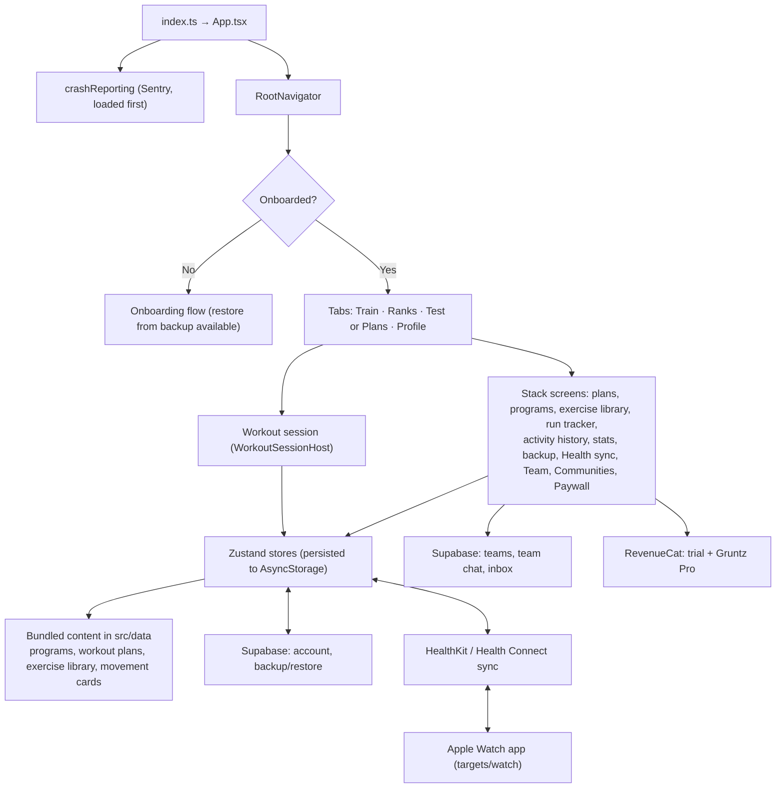

# Gruntz

Gruntz is an offline-first Expo / React Native fitness app built around military fitness tests. Training, logging,
XP, ranks and streaks all run on the device from bundled data; an account is optional and only adds backup,
teams and chat.

## How the app fits together



## Navigation

- **Tabs** (`src/navigation/RootNavigator.tsx`, custom bar in `TabBar.tsx`): `Train`, `Ranks`, `Test` for
  military users or `Plans` for everyone else, and `Profile`.
- Everything else is a stack screen: workout/plan/program detail, exercise library, routines, run tracker and
  activity history, stats and weekly debrief, achievements, backup, data transfer, Health sync, settings, team,
  communities, paywall.
- The live workout is a session overlay (`src/components/session`) that minimizes to a mini bar.

## State (`src/store`)

| Store | Holds |
| --- | --- |
| `useUserStore` | Profile, settings, XP, rank, streak, completed missions, achievements |
| `useSessionStore` | The in-progress workout (sets, rest timer); writes debounced to disk |
| `useExerciseLogStore` / `useExerciseNotesStore` | Per-exercise set history and notes |
| `useProgramStore` | Selected built-in program and progress |
| `usePlanLibraryStore` | Followed library plan and completed days |
| `useRoutineStore` | User-built routines |
| `useReadinessStore` | Fitness test scores/attempts, tracked activities (routes stored as files) |
| `useChallengeStore` | Daily challenge progress |
| `useHealthStore` | Health connection and sync preferences |
| `useSubscriptionStore` | Trial window and RevenueCat entitlement |
| `useTeamInboxStore`, `useOnboardingDraftStore`, `useUiStore` | Team unread state, onboarding draft, transient UI |

Persisted stores are versioned; bumping a store's `version` needs a real `migrate`, because backups made by one
build are restored by another (`src/services/backupRestoreStores.ts`).

## Services (`src/services`)

- **Supabase** (`supabaseClient.ts`, `backup.ts`): optional email-code sign-in, full-state backup and restore,
  account deletion (edge function in `supabase/functions/delete-account`). Off when the build has no Supabase keys.
- **Teams** (`teams.ts`, `teamChat.ts`, `teamInbox.ts`): teams with Chat, Leaderboard and Members; only after sign-in.
- **Crash reporting** (`crashReporting.ts`): Sentry, off in development and without `EXPO_PUBLIC_SENTRY_DSN`;
  reports carry no personal data.
- **Billing** (`subscription.ts`): RevenueCat trial and Gruntz Pro entitlement.
- **Health** (`healthSync.ts`): imports workouts from and writes activities to HealthKit (iOS) or Health Connect
  (Android).
- **Activity tracking** (`activityTracking*.ts`): GPS run/ruck tracking, including in the background.
- **Notifications and retention** (`notifications.ts`, `retention*.ts`): reminders, rest timers, trial nudges.

## Subscriptions and restore

Gruntz Pro is tied to the Apple ID / Google account through RevenueCat, which is the
only source of truth. The app checks it at launch, live, and when it comes back to the
foreground; offline, the last confirmed answer is trusted for 72 hours. "Restore
purchases" is on the welcome screen, the paywall and in Settings. One device at a
time: the RevenueCat dashboard must use **Restore Behavior → Transfer to new App User
ID**, and a phone that loses Pro this way shows a sheet to move it back. Progress
restores separately through the optional email backup. Details, dashboard settings,
review notes and the test checklist: [docs/subscription-restore.md](docs/subscription-restore.md).

## Apple Watch

`targets/watch` is a native watchOS app (via `@bacons/apple-targets`) that records workouts into Health; the
phone imports them through Health sync.

## Website

`website/` is the marketing site, a separate Astro package with its own `package.json`.

## Development

```bash
npm start            # Expo dev server
npm run ios          # build and run on iOS
npm run android      # build and run on Android

npm run typecheck    # tsc --noEmit
npm test             # node:test suites in tests/*.test.cjs
npm run site:build   # build the website
npm run check        # typecheck + tests + site build
```

iOS layouts must work in any window size (iPhone Duo, iPhone Mirroring, iPad multitasking); see `AGENTS.md`.
